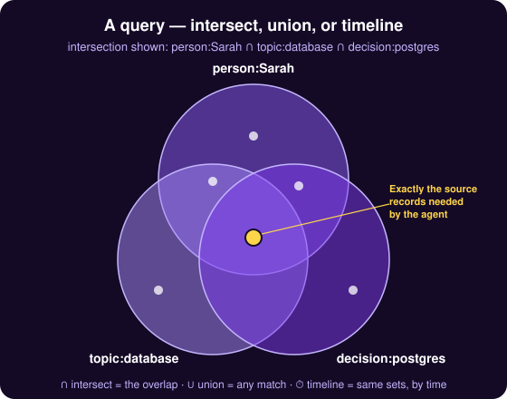

# Edge Property Hypergraph

Retrieval by embeddings alone is not enough: similarity finds what reads like a question, not every record that concerns the same client, matter or person. Building a physical graph is no better — its nodes and edges must be extracted, stored and kept in step as the work changes. The Edge Property Hypergraph is a dynamic graph instead: records carry labels and label:value properties, and the graph materialises only when a query asks for it — an intersection, a union, a walk outward from one record — finding the records in one place or within a blast radius of it; at retrieval, those results combine with search by meaning, words and time into one hybrid answer, limited to the lanes the agent may read.

Challenges addressed: [Context Window Limits and Lossy Compaction](../use-cases/beyond-the-context-window.md), [Multi-Agent Coordination](../use-cases/agent-swarm-coordination.md).

## Concepts

A graph database keeps edges as objects of their own. That is a second system to run, to keep consistent with the first, and to protect with the same access rules.

Everything Memory keeps no edge objects. The Edge Property Graph is a **hypergraph**: each edge property is a hyperedge that joins every record carrying it. Each [edge property](../data-model/edge-properties.md) is one row in a Postgres table: a record's id, a label and a value. Two records that hold the same label and value are joined when a query asks. That is the **edge property graph** (EPG): the records are its vertices, and a shared edge property is an edge.

## Four structural retrievals

Think of it as a Venn diagram. Each edge property is a set, and a query can **intersect** them (records matching every condition), **union** them (any match), or run as a **timeline** (the same sets, ordered by time). The structure picks out exactly the right records.




| Retrieval | Call | Returns |
|---|---|---|
| Intersect | `e_gather`, action `intersect` | Records that carry every edge property in `match`. A term with no label matches the records' words instead |
| Union | `e_gather`, action `union` | Records that carry any edge property in `match`. A term with no label matches the records' words instead |
| Traverse | `e_gather`, action `traverse` | Records that share an edge property with the record named in `sr_id` |
| Timeline | `e_timeline`, action `intersect` | Records that match the terms in `match`, as an edge property (by substring) or as a tag, ordered by time and bounded by `start_date` and `end_date`. When more than 200 records match, the most widely shared terms are dropped one at a time, until 200 or fewer match or one term is left; `time` and `duration` terms are never dropped. The reply's `hint` names the terms kept and dropped |

`e_gather` also counts without returning records. The action `count` sizes a result before it is fetched, and `group` lists the values of one label with the number of records under each.

Traverse follows the least-shared edge properties first, because an edge property held by few records says more than one held by many. It also follows the reserved edge properties the engine writes for [connections](../data-model/connections.md) and [adjustments](../agents-how-to/evolving-a-fact.md).

Structural retrieval is one leg. The action `find` takes a question in plain language and combines four lookups — the records' tags and edge properties, full text, record vectors and window vectors — into one ranked page; see [how search ranks results](how-search-ranks-results.md). See [the pipeline and its plugins](../reference/advanced-settings/pipeline-and-plugins.md).

## Example
Two records exist: the signed Acme contract, and a record about Sarah. The agent asserts a relation between them with a [connection](../data-model/connections.md).

```text
e_property {"action": "connect", "sr_id": ["sr_7b22e4d1a90c3f5812ab94c6e0d3f7a1", "sr_91c0aa5e2d64b7f3a8e1c05d9b7342fe"], "hint": "signed_by"}
```

```json
{
  "action": "connect",
  "property": "e_connect:signed_by_3a9f0c27d14e4b6a8e5f9d01c2b7a6e3",
  "members": ["sr_7b22e4d1a90c3f5812ab94c6e0d3f7a1", "sr_91c0aa5e2d64b7f3a8e1c05d9b7342fe"],
  "stamped": ["sr_7b22e4d1a90c3f5812ab94c6e0d3f7a1", "sr_91c0aa5e2d64b7f3a8e1c05d9b7342fe"]
}
```

Later, an agent that knows only the contract walks out from it.

```text
e_gather {"action": "traverse", "sr_id": "sr_7b22e4d1a90c3f5812ab94c6e0d3f7a1"}
```

The reply holds the neighbouring records in `srs`, including Sarah's. It also holds `origin_edges`: each edge property on the contract, with the number of other records that share it.

```json
{"label": "e_connect", "value": "signed_by_3a9f0c27d14e4b6a8e5f9d01c2b7a6e3", "sr_count": 1}
```

## Implications
**There is one database to run.** The graph is a table beside the records, in the same Postgres.

**Edges need no upkeep.** Adding an edge property links the record to every record that already holds it. Deleting the edge property removes those links.

**Records are limited by lane; some counts are not.** Records returned by a structural retrieval, and the `count` and `group` actions, are limited to the lanes the agent profile named on the call can read. The per-term counts `intersect` reports, and the edge properties of the record a traverse starts from with their counts, cover all lanes. See [lanes, agent profiles and policies](../governance/lanes.md).

**Tags are not edges.** Traverse follows the edge properties on a record: those callers wrote, and the reserved edge properties for connections and adjustments. It does not follow the tags the extractors derive, the label `tense`, or edge properties skipped for the budget.

**Deep graph analysis is out of reach.** Shortest paths and multi-step patterns are not offered.

## Reference

The tools, their arguments and their refusals: [`e_gather`](../reference/tools/e_gather.md), [`e_timeline`](../reference/tools/e_timeline.md) and [`e_property`](../reference/tools/e_property.md).
