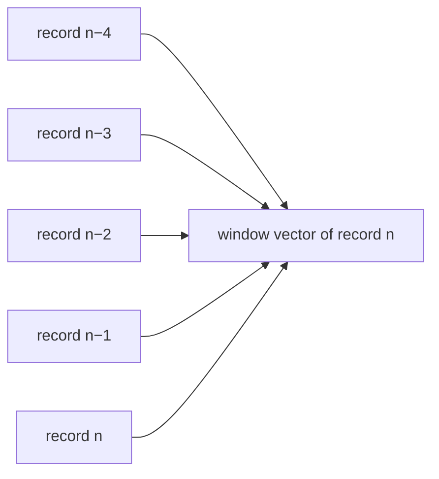

Challenges addressed: [Context Window Limits and Lossy Compaction](../../use-cases/beyond-the-context-window/), [Vendor-Independent Memory](../../use-cases/vendor-independent-memory/).

## Concepts

An embedding space is one embedding route — its model and its task prefixes — at one vector width, with its own table of vectors. Changing the route starts a new space, and the engine embeds every record into it in the background. Until that work finishes, similarity search sees only the records already embedded in the new space.

A vector from one embedding model cannot be compared with a vector from another. A memory that keeps both in one table returns wrong neighbours, or fails when the widths differ.

So the engine keeps one space per route. A space's identity is the route's model, its task prefixes, and its vector width. Each space has its own table, created the first time a vector is written to it.

The engine embeds through the stack's [model gateway](../../architecture/microservice-architecture/#models), an OpenAI-compatible endpoint. `EMBEDDING_BASE_URL` names the endpoint, including `/v1`, and `EMBEDDING_MODEL` names the route. Both are required: the engine and its workers refuse to start without them.

| Route (`EMBEDDING_MODEL`) | Served by | Width | Task prefixes |
|---|---|---|---|
| `nomic-embed-text` (default) | The stack's own embedding model: llama.cpp with nomic-embed-text v1.5. No key; nothing leaves the machine | 768 | `search_document: ` before each record, `search_query: ` before each question |
| `text-embedding-3-small` (the switch) | OpenAI's model through OpenRouter. Needs `OPENROUTER_API_KEY` in the gateway's settings; record text is sent to the provider | 1536 | None |

Routes are declared in `conf/gateway.yaml`. A route's task prefixes are part of its space: vectors made with different prefixes are not compared. To change a route's prefixes, give it a new name, which opens a new space.

The width of a space, and its task prefixes, are the ones the gateway declares. The engine reads `GET <EMBEDDING_BASE_URL>/model/info`, finds the entry whose `model_name` is `EMBEDDING_MODEL`, and takes its `output_vector_size`, `document_prefix` and `query_prefix`. It does not guess a width and does not learn one from a vector.

:::warning
While the width is not declared, cannot be read, or differs from the width of a vector the endpoint returns, nothing is embedded. Ingest still succeeds and the record waits for the sweep. Searches run without similarity, the exchange sends no vectors, and `/health` reports `degraded`, with the reason under `embedding.state`: `undeclared`, `unreachable` or `mismatch`. The engine reads the route again at most once a minute.
:::

The space for the configured route and the declared width is the active space. Every search reads it and every vector this engine computes is written to it.

## What changes when you change the model

:::warning
The old space does not keep answering. Once the engine restarts with a new model, every search reads the new space. A record is found by similarity search only after it has been embedded there.
:::

A scheduled sweep finds the records with no vector in the active space and queues all of them, in jobs of 50, on the maintenance worker. It runs when the worker starts and then every hour, and needs `CRON_ENABLED=true`. While the jobs from one pass are still queued, the next pass queues nothing. A record whose embedding failed is still missing, and the next pass after the queue drains takes it again.

The old space's table stays in the database. Set the model back and it is the active space again, with its vectors in place. The engine never removes a space.

## What a space holds

| Collection | Contents |
|---|---|
| `source_records` | Each record's vectors. A long record is split into chunks, one vector per chunk |
| `window_source_records` | One vector per window of consecutive records |

A record is embedded in at most `EMBED_MAX_CHUNKS` chunks (default 64). Text past the last chunk is not embedded, and the engine logs the record.

Dialogue isn't atomic — a single turn often only makes sense with the turns around it. Records marked conversational join a continuum, so when one matches, eMemory expands the window and pulls in the turns before it too: you get the answer and the exchange it lived in, not one sentence stranded from its context. Window vectors are for records marked as conversation or as file content. Those records form streams, one per kind (conversation or file) and source system, ordered by ingestion time. Each record in a stream has one window vector: the mean of its own vector and those of up to four records before it in the stream (`WINDOW_EMBED_SIZE`, default 5), taken inside one space. The first record of a stream has none.



When question search matches a window vector, it returns the records the window was made from. See [finding records](../../agents-how-to/finding-records/).

## Example
Acme's stack runs as shipped, on the local route.

```bash
EMBEDDING_MODEL=nomic-embed-text
```

The gateway declares a width of 768 and the route's task prefixes, so every record is embedded as `search_document: <text>` and every question as `search_query: <text>`, into one space. Sarah asks about the renewal and similarity search returns the record.

Acme switches to the OpenRouter route: it puts `OPENROUTER_API_KEY` in the gateway's settings and restarts the stack with

```bash
EMBEDDING_MODEL=text-embedding-3-small
```

The first vector written creates a second space, 1536 wide, with no prefixes. For a while Sarah's question finds nothing by similarity, because the renewal record has no vector there yet. The sweep works through the records, and builds the space's nearest-neighbour index when the space has none; until then, search scans the table. Switching back to `nomic-embed-text` makes the first space active again, with its vectors in place.

## Implications
**A model you serve yourself is a space like any other.** Where the model runs is no part of a space's identity.

**A tombstone reaches every space.** Deleting a record deletes its own vectors in all of them. A window vector it contributed to remains until that window is recomputed. See [tombstones](../../agents-how-to/deleting-a-record/).

**Vectors cross to a peer only into a matching space.** A peer with no space for that model and width skips the vector and embeds the record itself. See [the exchange](../../architecture/distributed-mesh-architecture/).

**The archive keeps vectors per space.** A rebuilt engine reads back the active space's vectors only. See [the archive](../../durability/archive-and-restore/).

## Reference

Every setting and its default: [embeddings configuration](../../configuration/embeddings/).
