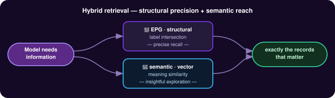
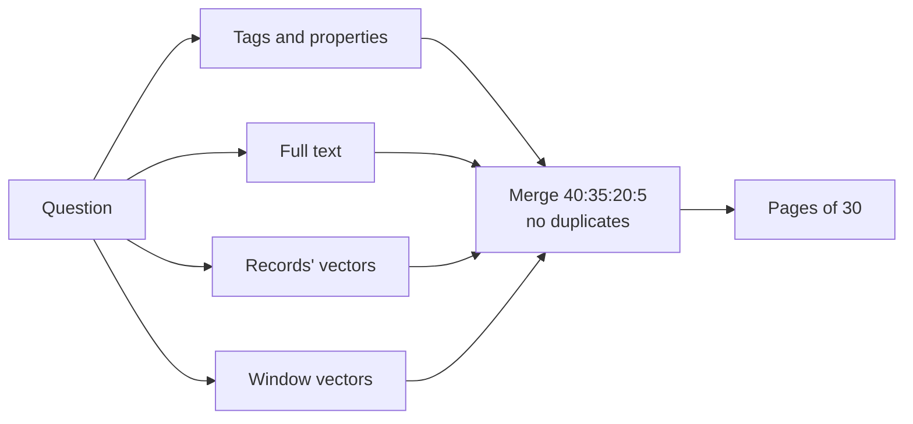

# Hybrid Retrieval Strategy

Embeddings alone are not enough for a system of record: similarity finds text that reads like the question, but misses exact names, figures and labels, and returns what is merely nearby instead of everything that concerns the matter at hand. Yet agents still need search by meaning to get into the right area, and then properties to zero in on exactly the records they need — which is why retrieval is hybrid. It answers one question with four lookups at once — tags and edge properties, full text, record vectors, and the windows around conversation and file records; merges them into one ranked list without duplicates; returns it in pages; and still answers from tags, edge properties and full text when embeddings are unavailable.

Challenges addressed: [Context Window Limits and Lossy Compaction](../use-cases/beyond-the-context-window.md).

## Concepts

`e_gather` `find` merges four lookups — tags and edge properties, full text, record vectors and window vectors — into one ranked list, in fixed proportions, and pages are cut from it.

The EPG gives you exactness: intersect labels and you get every record that matches, nothing that doesn't. But exact filtering can't surface the thing you didn't know to ask for. So eMemory runs semantic (vector) search alongside the EPG — meaning-similarity that finds related records even when they share no label. Structure for precise recall, semantics for insightful exploration, in one query.

## The four lookups

`find` runs the components the pipeline profile (`PIPELINE_PROFILE`) lists for question search. Under the shipped profile, `profile_v1`, four lookups run:

| Lookup | What it matches |
|---|---|
| Tags and edge properties | The question's words against the records' tags and edge properties |
| Full text | Names and terms in the question that WordNet does not know, by PostgreSQL full-text search |
| Records' vectors | The question's vector against each record's vector in the active [embedding space](embedding-spaces.md) |
| Window vectors | The question's vector against the window vectors of conversation and file records; a matching window adds the records it was made from |

Tag, edge property and full-text candidates are given the cosine distance between the question's vector and the record's vector; a record with no vector yet gets the worst distance. Window candidates carry their window's distance. The four lists, each sorted by distance, are interleaved in the proportions 40:35:20:5 (record vector : tag or edge property : window : full text), without duplicates. Every candidate is kept, and pages are cut from the merged list. A page holds 30 records unless `page_size` says otherwise.

:::warning
When the embeddings endpoint is not usable, the two vector lookups return nothing and `find` answers from tags, edge properties and full text alone. Their distances are then placeholders, not cosine distances. `/health` reports `degraded` while the gateway's model declaration cannot be read or does not match its vectors.
:::

## Signals kept out of the ranking

- A record's authority.
- Dates. `find` has no date bounds; [the timeline](../agents-how-to/using-the-timeline.md) does.

:::warning
A page is cut before records in lanes the agent profile cannot read are removed. A page can therefore hold fewer records than its size, and `total_pages` counts records in every lane.
:::

## How to use it

[Finding records](../agents-how-to/finding-records.md).
