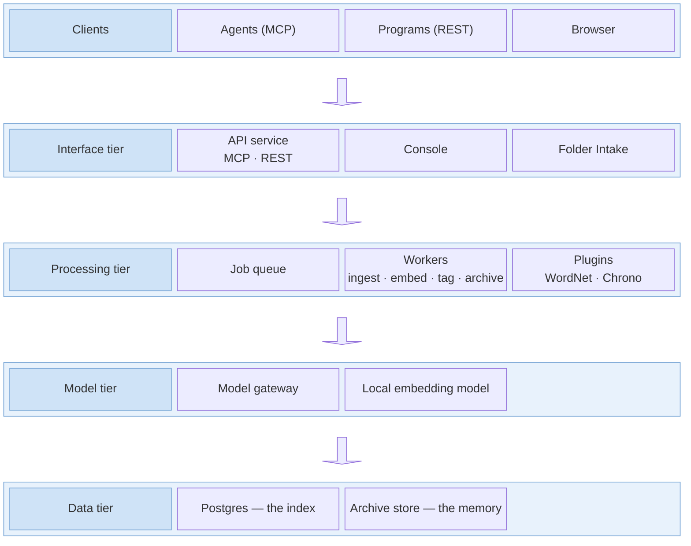

The stack is one Docker Compose file, run on your hardware with no internet access needed. Two services are published, to the machine the stack runs on and to it alone: the API service and the console. Every other service is reached only by the others, by name, on the stack's own network.

## The services

### Core

The engine is the API service and its workers together.

| Service | Container | What it is | Holds or does |
|---|---|---|---|
| API Service (MCP and REST) | `ememory-api` | The engine's front: the MCP server and the REST API | Serves the MCP tools and the REST API, the change feed and the exchange with peers. Runs the database migrations when it starts |
| Workers | `ememory-worker-ingest`, `ememory-worker-archive`, `ememory-worker-maintenance`, `ememory-worker` | Four background workers, on the same image as the API service | Ingest: the part of each write that runs after the call returns (the extractor plugins and the embedding). Archive: writes to the archive. Maintenance: batches of repair work, such as embedding every record after the embedding model changes. Scheduled (`ememory-worker`): jobs when `CRON_ENABLED=true`, window embedding, and dialling peers |

### Broker

| Service | Container | What it is | Holds or does |
|---|---|---|---|
| Message Broker | `ememory-redis` | Redis 7 | The queue of background jobs and the change feed's live messages. Nothing is written to disk |

### Indexing

| Service | Container | What it is | Holds or does |
|---|---|---|---|
| Database | `ememory-postgres` | PostgreSQL 17 (Percona), with pgvector and pg_tde | The live index: records, edge properties, vectors, corrections, the audit log, policies. Encrypted at rest by pg_tde, with its key in its own volume |

Qdrant is not in the default stack; an overlay file adds it (below).

### Plugins

| Service | Container | What it is | Holds or does |
|---|---|---|---|
| Chrono Plugin | `plugin-chrono`, `chrono-engine` | Extractor plugin | Reads dates, times and date ranges from a record's content, using chrono-node |
| WordNet Plugin | `plugin-wordnet` | Extractor plugin | Reads a record's words, using WordNet. Its corpus is in its image |

What the extractor plugins return is kept as each record's **tags**, which search reads; tags are not edge properties.

### Models

| Service | Container | What it is | Holds or does |
|---|---|---|---|
| Model Gateway | `gateway` | Embeddings gateway (LiteLLM) | The OpenAI-compatible endpoint the engine embeds through. It routes the model name to a provider, and holds any provider keys in its own settings file |
| Embedding Model | `local-embed` | Local embedding model | llama.cpp serving nomic-embed-text v1.5 (768 dimensions, CPU), the default route. The model is in its image |

The default route needs no key and sends nothing off the machine. The gateway can be switched to a provider's route, which then receives record text.

### Persistence

| Service | Container | What it is | Holds or does |
|---|---|---|---|
| Archive Store | `archive-store`, `archive-bucket` | SeaweedFS | The [archive](../../durability/): S3-compatible object storage on local disk, in the host folder `ARCHIVE_DIR` |

### Interfaces

| Service | Container | What it is | Holds or does |
|---|---|---|---|
| Console | `console` | Web interface and its backend, one Node process | Holds the engine client key server-side in the sign-in session and passes `/api` to the API service. Published to this machine only |
| Folder Intake | `folder-intake` | Its own compose file (`docker-compose.folder.yml`) | Watches a folder on this machine, mounted read-only, and writes its files to the API service. See [documents and files](../../use-cases/beyond-the-context-window/#documents-and-files) |

## Overlays

| Service | Container | What it is | Holds or does |
|---|---|---|---|
| Open Network Access | `ememory-api` (in `docker-compose.open.yml`) | Overlay file | Publishes the API service on every interface, and turns authentication on |
| Vector Store | `qdrant` (in `docker-compose.qdrant.yml`) | Qdrant | Keeps vectors in Qdrant instead of PostgreSQL |

## The API service's interfaces

| Path | What it is |
|---|---|
| `/mcp` | MCP over streamable HTTP: the ten tools, and the instructions an agent receives when it connects |
| `/mcp/sse` | The same MCP server over the older SSE transport |
| `/api/v2/` | The REST API: the tool operations, and routes for policies and agent profiles, lanes, edge properties, records, embedding spaces, bundle export and import, and administration |
| `/api/v1/feed` | The change feed, as server-sent events |
| `/api/v1/sync/` | The exchange between peers |
| `/health` | The engine's health: `healthy`, or `degraded` when the database is unreachable, or when the embedding width is not declared, cannot be read, or differs from the width of a vector the endpoint returned. The pipeline profile and the temporal profile in force are named in the reply. |

`e.sh` is a command-line script over the REST API, for agent profiles, lanes, policies, records, edge properties, peers, ingesting files, bundle export and import, and minting client keys.

See [configuration](../../configuration/) for every setting.
