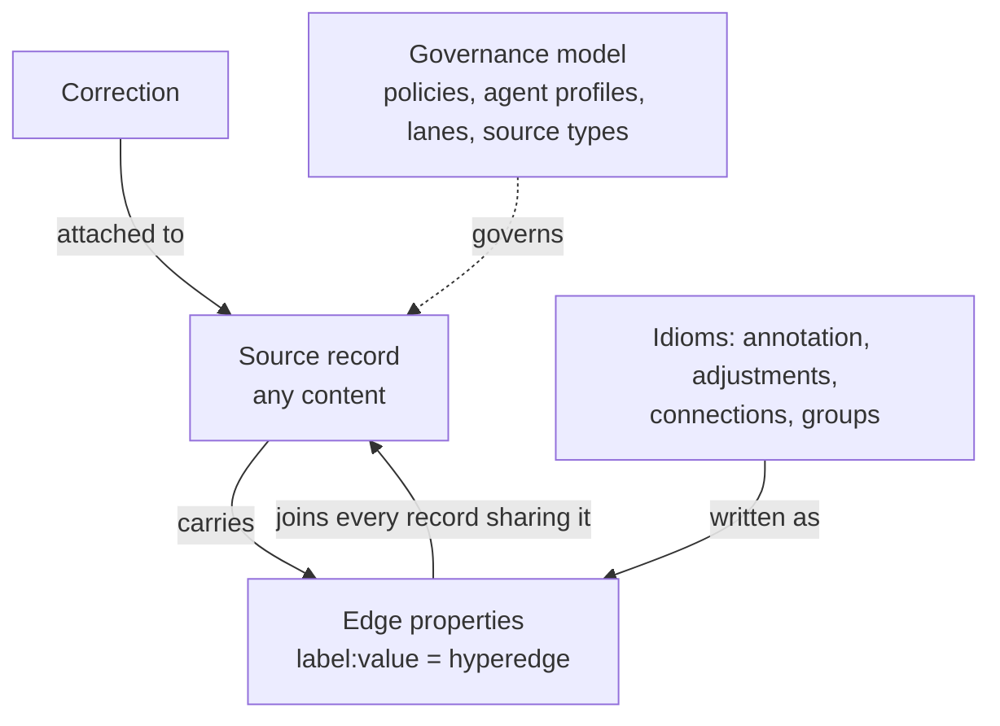

The model is designed to be as simple as possible while providing maximum flexibility in what it can represent.

## The parts

**Source record.** Data — any content an agent or a program stores: a sentence, a document, a large JSON object, a part of a file — kept as it was written, with its source type, [authority](authority/), the system that wrote it and when. See [source records](source-records/).

**Edge properties.** The core of the data model: `label:value` pairs on a record, like `person:Sarah` or `topic:database`. When two or more records share one, an edge is imputed — one N-ary edge touching every record that carries it. The records and their edge properties form the Edge Property Graph, a hypergraph. Agentic annotation, adjustments (a linked list), connections (1-to-1) and groups (membership) are idioms on that one mechanism. See [edge properties](edge-properties/).

**Connections and groups.** The asserted kind of edge: a named relation or membership, written by the engine as one reserved edge property value shared by every member. See [connections](connections/) and [groups](groups/).

**Authority.** How much weight a record carries, set by its source type and returned by `e_read`. See [authority](authority/).

**Corrections.** The truth, attached to the record it corrects. The record's content is not changed. See [corrections](../agents-how-to/correcting-a-record/).

**Adjustments.** A newer record linked to an earlier one that was right and has since changed. See [updates and adjustments](../agents-how-to/evolving-a-fact/).

**Governance.** Policies, agent profiles, lanes and source types decide who reads and writes what, and what a record may be. See the [governance model](../governance/).

**Durability and the mesh.** The [archive](../durability/) keeps a copy from which an engine is rebuilt; the [mesh](../architecture/distributed-mesh-architecture/) exchanges records between engines.
