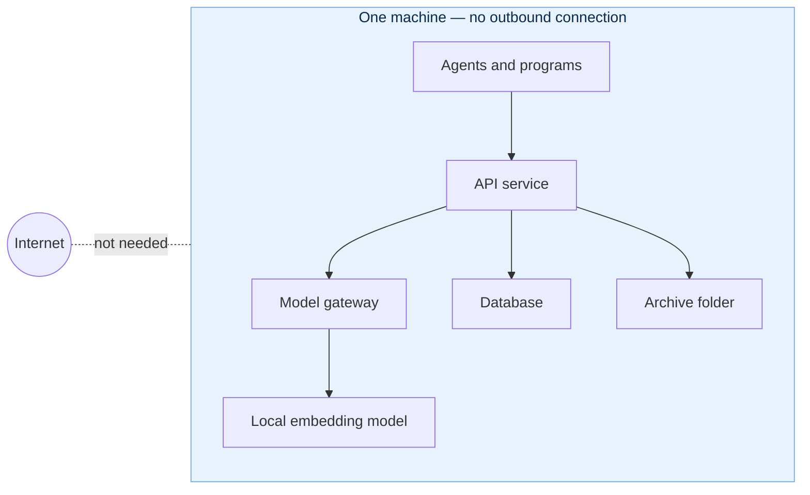

# A Single Stack on One Machine

One stack on a laptop or a server, isolated by default: once its images are pulled it needs no internet at all, and a hosted embedding model is one setting away if you want one.

The default, and isolated out of the box. One stack on a laptop or a server, with its database and its archive folder on that machine; agents and programs on the same machine reach the API service and the console; nothing off the machine can.

Once its images are pulled, the stack needs no internet at all: the embedding model runs inside it, the archive is on local disk, the plugins carry their data in their images, and nothing in it calls out. For a site with no connection even to pull, the images load from files instead.

**A hosted embedding model, if you choose one.** The model gateway can also route to a hosted model through OpenRouter, such as OpenAI's `text-embedding-3-small`: put an OpenRouter key in `gateway.env` and name the model in `EMBEDDING_MODEL`. Then, and only then, the stack calls out — to OpenRouter, for embeddings. Switching back to the local model is the same one setting. See [flexible embedding spaces](../architecture/embedding-spaces.md).

Guides: [Single Stack](../operator-guide/single-stack.md), [Offline Stack](../operator-guide/offline-stack.md) (no connection at all, images loaded from files).
