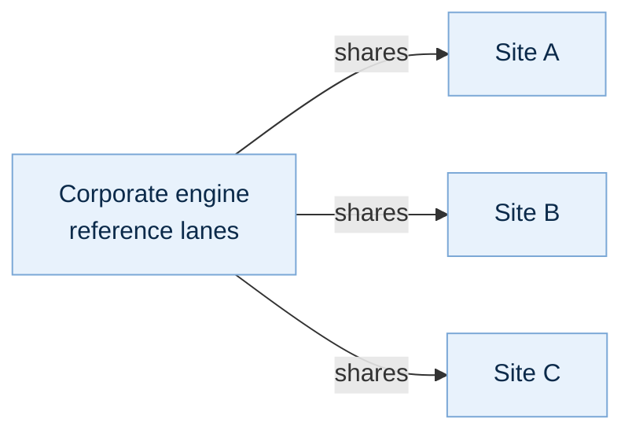
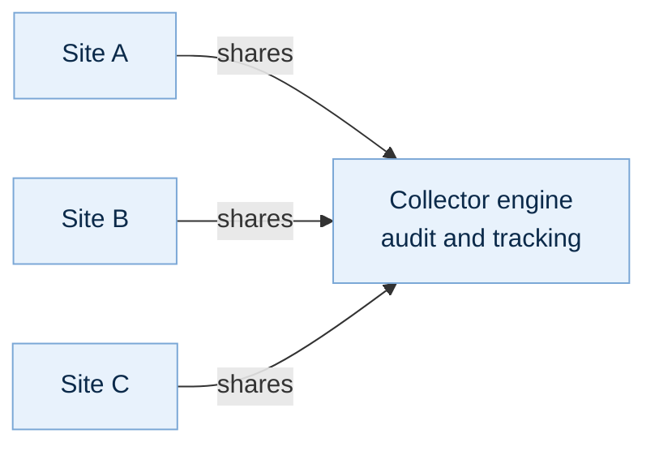
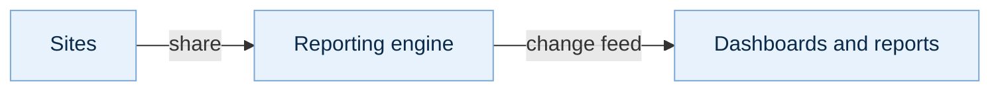
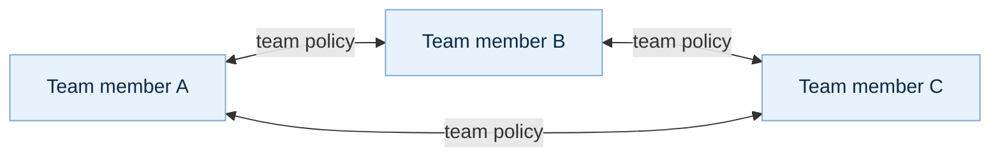
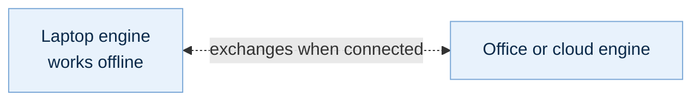

Every pattern below uses the same two choices — an owner **shares** a policy, a peer **accepts** it — and the same agent profiles. Combine them freely: one engine can be in several patterns at once.

## A realm: reference memory every site reads

A **realm** is the set of engines that take one organisation's reference memory — policies, product facts, approved procedures. One engine holds it and shares it; every site accepts it, and its agent profiles grant only **read** on those lanes, so sites use the reference memory and add their own work beside it, in their own lanes.

## A collector: one place to audit and track

Sites share the policies whose work must be overseen; a collector engine accepts them all. It holds those records with every version and the audit events about them, so auditors and trackers work in one place, while each site's other lanes stay home.

## Reporting

A reporting engine accepts what the reports need and gives its agents and programs read-only profiles. Dashboards follow changes live through its [change feed](../../observability/change-feed/), with no load on the sites that wrote them.

## Work groups

A team's engines share one team policy with each other, both ways: everyone in the group reads and builds on the group's memory, and nothing outside that policy leaves anyone's engine.

## Travel and remote work

A laptop runs its own engine, the real thing rather than a cache. Offline — on a plane, at a remote site — its agents keep reading and writing; when it reconnects, it exchanges what it missed with the engines it peers with, in both directions.

