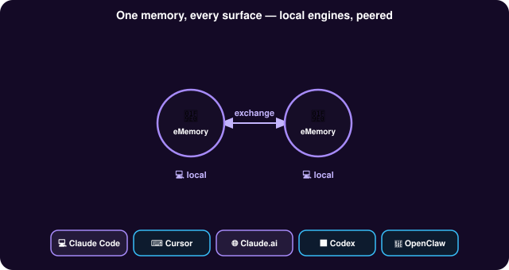

# Stacks in a Mesh

Agents and eMemory engines entirely inside your walls, peered over your LAN or across sites, each holding what it accepted — no cloud and no internet.

Run a fleet of agents entirely inside your walls. Each machine hosts its own agents and its own eMemory; they peer over your LAN or across sites, and each holds the lanes it has accepted. No cloud, no internet: a private memory mesh that never leaves the building.

What crosses is your choice, per peer: one side shares a policy, the other accepts it, and only the lanes of a policy that is both shared and accepted are exchanged. Each stack keeps its own database and archive.

Guide: [Stacks in a Mesh](../operator-guide/stacks-in-a-mesh.md).
