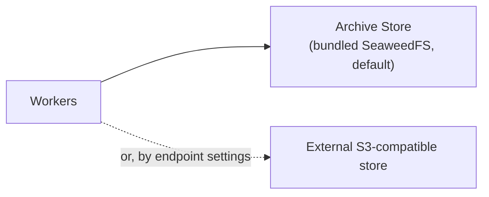

# Archive and Restore

Anyone running memory in production needs it to survive the loss of its database, and its history kept even after records are deleted. The archive writes every record version, correction, policy event, audit event and vector to S3-compatible storage — the bundled store or one of their own — with object bodies encrypted; an engine that loses its database starts on an empty one, rebuilds from the archive and reports when it has finished; and the engine never deletes an object from the archive.

Challenges addressed: [Auditable Decision-Making](../use-cases/auditing-agentic-decisions.md), [Tracking Changes Through Time](../use-cases/data-evolution.md).

## Concepts

Records, corrections, policy events and audit events are written as objects to S3-compatible storage shortly after each change, and an engine that loses its database rebuilds from the archive.

Postgres is the live index; the archive is the durable store it can be rebuilt from. The index is replaceable by design.

The writes are asynchronous. A write is queued after the caller is answered, and audit events are written by a task that runs every five minutes. The archive does not hold credentials or window vectors.

When the database is gone, the engine boots on an empty one and replays the archive: it stores each record's entries and projects each record's latest state, with this engine's own deletions, into the cache retrieval reads.

## What turns it on

The archive is on in the shipped stack. It is stored by the bundled archive store: SeaweedFS, S3-compatible, writing to the host folder `ARCHIVE_DIR`, which is bind-mounted into it. Endpoint settings point it instead at an external S3-compatible store, such as DigitalOcean Spaces, Amazon S3 or MinIO. The engine reaches the archive through an S3-compatible API only.



| Setting | What it does |
|---|---|
| `ARCHIVE_ENABLED` | `true` in the shipped stack |
| `ARCHIVE_ENDPOINT_URL`, `ARCHIVE_BUCKET` | Where the archive lives |
| `ARCHIVE_ACCESS_KEY`, `ARCHIVE_SECRET_KEY` | The login for the archive store. Required |
| `ARCHIVE_DIR` | The absolute path of the host folder the bundled archive store writes to. Required; it must exist before the first start |
| `REDIS_PASSWORD` | The job queue's password. Required |
| `ARCHIVE_KEY` | The archive encryption key: the bodies of objects are encrypted with AES-256-GCM. Required. Object names, which include record ids, are not encrypted |
| `CRON_ENABLED` | Runs the restore sweep, the backfill from database to archive, and the audit archive |

The stack refuses to start without the archive store's login and the archive encryption key. `./e.sh init` generates all three.

## What to back up

Two things, kept apart from each other:

| Backup | Why |
|---|---|
| The `ARCHIVE_DIR` folder, or the external bucket | The archive itself |
| The archive key (`ARCHIVE_KEY`) | Without it, the archive's objects cannot be read |

The database needs no backup of its own: it is rebuilt from the archive, with new encryption keys of its own.

To move an engine to new hardware, give a fresh stack the same archive and `ARCHIVE_KEY`: it starts as the same engine. To keep a copy of a memory somewhere the engine cannot reach, or to bring it into another engine, export a bundle: see [engine identity and bundles](../governance/engine-identity-and-bundles.md).

## What the archive holds

| Prefix | Contents |
|---|---|
| `srs/` | Each version of each record — its whole state: content, lane, the edge properties declared on it, and whether it is deleted — one object per version. A rebuilt engine derives tags and extracted edge properties again from the content |
| `spaces/` | Each record's vectors, per [embedding space](../architecture/embedding-spaces.md) |
| `cors/` | Each version of a [correction](../agents-how-to/correcting-a-record.md) |
| `pol/` | Each policy event |
| `audit/` | The [audit log](the-audit-log.md), one object per engine per hour |
| `engine/` | The engine's identity and its local settings |
| `peers/` | The peer registry, without its keys |

## Example
Acme points its engine at its own S3-compatible store.

```bash
ARCHIVE_ENABLED=true
ARCHIVE_ENDPOINT_URL=https://objects.acme.example
ARCHIVE_BUCKET=acme-memory
ARCHIVE_ACCESS_KEY=<access key>
ARCHIVE_SECRET_KEY=<secret key>
ARCHIVE_KEY=<openssl rand -base64 32>
CRON_ENABLED=true
```

The database volume is lost. Acme starts the engine on an empty database with the same settings.

1. At boot the engine reads `engine/` and resumes its identity. It puts back the policy events and the peer registry.
2. The sweep runs when the worker starts, then on a schedule. It restores records, with their history and this engine's own deletions, then everything else.
3. Acme asks the engine whether it has finished.

```bash
curl -H "Authorization: Bearer $EMEMORY_API_KEY" https://memory.acme.example/api/v1/sync/status
```

```json
{
  "archive_enabled": true,
  "restore_converged": true,
  "archive_empty": false
}
```

`restore_converged` is `true` only when the last sweep finished reading the archive, the archive was not empty, and the sweep brought nothing back. An object it could not decrypt, or a fetch it abandoned, keeps it `false`; a record it refused, such as a deleted one, does not. It is `false` while a sweep is still running and when the archive is off, and `null` before any sweep has run. `archive_empty` is `true` when the sweep finished and every prefix it listed was empty: a wrong prefix, or an archive nothing was written to. `last_sweep.counters` in the same response counts what the last pass restored and what it refused.

## Implications
**The engine never deletes an object from the archive.** It has no delete call for object storage. It does overwrite vector, peer, identity and audit objects in place; record versions, corrections and policy events are written once. A deleted record's objects stay there: a restore brings the record back deleted, and refuses its vectors, counting them as `embeddings_skipped_tombstoned`.

**Credentials are not in the archive.** A restored peer comes back with its cursors and the status `needs_credential`. It exchanges nothing until it is re-keyed; then it returns to `active` with its restored cursors. For a peer with a `peer_url`, send `POST /api/v1/sync/peers` again with that `peer_url` and its `auth_token`. For a peer with no `peer_url`, mint a new key with `POST /api/v1/sync/peers/{peer_id}/inbound-key` and give it to that peer.

**The encryption key is not in the archive.** An object the engine cannot decrypt is skipped and counted as `undecryptable`. Keep `ARCHIVE_KEY` somewhere else.

**The sweep repairs both directions.** A record in the database with no object is written to the archive on the next pass. Corrections are the exception: a correction is written when it is made, and the sweep does not write one that was missed.

**A restore fetches in parallel.** It fetches one object per record version, `RESTORE_FETCH_CONCURRENCY` at a time (default 16).

## Reference

Every setting: [archive configuration](../configuration/archive.md).
