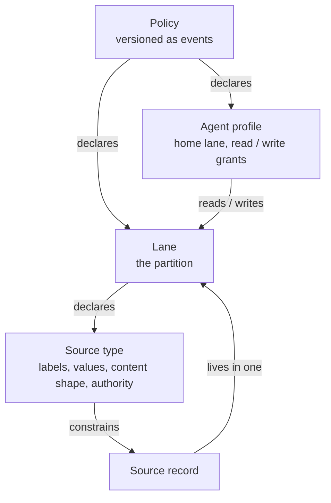

**Policies.** A policy is a YAML document that declares lanes, their source types and agent profiles. Each upload is a policy event; the rules in force are computed from the events, so every version is kept. See [policies](policies/).

**Agent profiles.** An agent profile grants read and write per lane and names a home lane, where records go unless the call names another. The caller names its agent profile on each call. See [agent profiles](agent-profiles/).

**Lanes.** The partitioning mechanism: every source record lives in exactly one lane, and access and vocabulary are decided per lane; a lane's records cross the mesh with its policy, when that policy is shared and accepted. See [lanes](lanes/).

**Source types.** Declared on a lane, a source type types a record and constrains its edge-property labels, label values and content shape, and sets its authority. A lane with source types accepts only those. See [source types](source-types/).

**Engine identity, bundles and take-over.** Every engine has an identity that every write carries. A memory moves between engines as a bundle: imported as is, merged beside another engine's memory, or taken over by a new engine. See [engine identity, bundles and take-over](engine-identity-and-bundles/).

**The deletion switch.** Whether records may be deleted at all is the engine owner's choice, made once, in one setting. See [the deletion switch](deletion-switch/).

**Peering.** Which engines this one trusts, which policies it offers, which it takes, and how to stop — each side deciding for itself. See [peering](peering/).

How callers sign in is set up in the operator guide: [eMemory SaaS](../operator-guide/auth-ememory-saas/), [your own identity provider](../operator-guide/auth-own-identity-provider/). The data these rules govern is described in the [data model](../data-model/).
