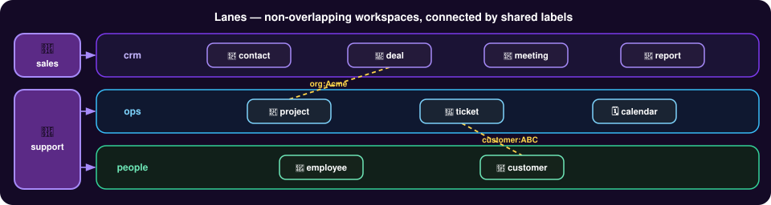

# Lanes

An owner needs to divide one memory into work areas and decide, for each, who reads and writes it, what its records may be and whether it ever leaves the engine. Lanes are declared in a policy; each is its UUID, so two lanes can share a name; agent profiles grant read and write lane by lane; a lane's source types close it to unlisted labels at write time; the shares of its policy decide whether its records cross to peers; and a shared name is shown qualified, never guessed.

Challenges addressed: [Auditable Decision-Making](../use-cases/auditing-agentic-decisions.md), [Multi-Agent Coordination](../use-cases/agent-swarm-coordination.md), [Enterprise Distributed Memory Requirements](../use-cases/enterprise-memory-mesh.md).

## Concepts

Every source record lives in exactly one lane, and access and vocabulary are decided per lane; a lane's records cross the mesh with its policy, when that policy is shared and accepted. The familiar picture is a swim lane: separate workspaces running side by side.

A **lane** partitions the memory. Every source record lives in exactly one lane, fixed when the record is written.

Everything that governs records is decided per lane:

| Decided per lane | By |
|---|---|
| Who reads and writes | [Agent profiles](agent-profiles.md): a home lane, plus read and write grants on other lanes |
| What a record may be and carry | The lane's [source types](source-types.md) and their labels. A lane with none is open |
| What crosses the [mesh](../architecture/distributed-mesh-architecture.md) | A lane's records cross to a peer with the policy that declares the lane |

A lane **is** its UUID (`lane_` followed by an identifier); its name is a label. Everything stored, compared or sent names a lane by its UUID — a record's lane, a grant, a home lane, what crosses to a peer. Lanes are declared in a [policy](policies.md). A new engine starts with one open lane, `default`.

## Lane labels

A name is shown and typed as a label, worked out for each view:

- **Bare name** — `crm` — where the name is unique among the lanes in the view.
- **Qualified** — `crm@3f9a2` — where two lanes in the view share a name: the name, `@`, and the shortest piece of the UUID (at least five characters) that tells them apart. A lane name may not contain `@`.

The view is what the caller can see. An operator's view is every lane the engine holds. An agent's view is the lanes its agent profile can read or write, so a qualifier never reveals a lane the agent cannot read, and a same-named lane arriving outside its reach never makes its bare names ambiguous.

A caller may type a full lane UUID, a qualified label, or a bare name unique in its view. An ambiguous or unknown name is refused, and the refusal lists the labels the caller may use. A label is never stored: a lane shown bare is shown qualified once a same-named lane it can see arrives.

## Swim lanes

The picture people recognise is the **swim lane**: a lane is a work area, and every record lives in exactly one. Lanes act as swim lanes: each can enforce its own source-type and label vocabulary (unlisted labels are rejected at write time), and every agent profile carries per-lane read and write grants — so teams stay in their own lane while shared lanes let them cross.



Records in different lanes are still linked by the edge properties they share. An agent profile that reads both lanes sees the link.

## Where a record goes

Writes land in the agent profile's `home_lane` by default (`assign_lane` to write elsewhere, which must be declared and writable by the agent profile); reads (`e_read`, `e_gather`, `e_timeline`, `e_audit`) span every lane the agent profile can see.

```text
e_ingest {"content": "Acme signed the renewal on 2026-10-05.", "source_type": "contract", "assign_lane": "accounts", "agent_profile": "support"}
```

```json
{"error": "agent_profile cannot write to lane 'accounts'; writable: ['notes']"}
```

## Reference

Agent profiles: [agent profiles](agent-profiles.md). Declaring lanes: [policies](policies.md).
