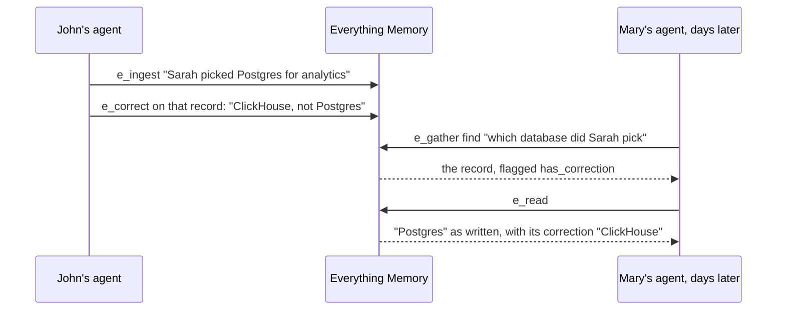

## Approach
A memory that overwrites loses what it used to say. One that only appends leaves the reader to guess which record is current.


Everything Memory is an epistemic data store: content changes only by update, and every earlier version is kept. Built-in journaling lets a model update a previously ingested fact or assertion using one of three mechanisms. **Adjustments** update an original source record that was not factually incorrect, but instead needed an update — to clarify, modify, record state changes — in a fully auditable way. **Corrections** let the model mark a source record as actually false; a correction can be retracted and replaced. **Tombstoning** moves a source record out of the knowledge base while leaving an audit trail behind. For a record that is itself an artifact — a plan, a status — an **update** writes its next version and keeps every earlier one.


| Change | Mechanism | What is kept |
|---|---|---|
| The record is an artifact that moved on (a plan, a status, a document) | An **update** with `e_update` writes its next version under the same `sr_id` | Every earlier version, in the record's ledger |
| The record was right and reality changed | An **adjustment**: a new record linked to the one it evolves, with `e_ingest` `adjusts`. Adjusting again adds the next link | Both records, linked |
| The record was wrong | A **correction**, attached to the record with `e_correct` | The record as written, with the correction beside it |
| The record should no longer be retrieved | A **deletion**, local to this engine and reversible with an undelete | The tombstone, the update ledger and the audit events |

See [updates and adjustments](../../agents-how-to/evolving-a-fact/), [corrections](../../agents-how-to/correcting-a-record/) and [deletion and tombstones](../../agents-how-to/deleting-a-record/).

This is what makes memory accountable instead of just stored — every change is kept, never silently overwritten.

The accumulation of adjusted and corrected knowledge over time allows your agent to truly learn your space. Through its tools, your agents can modify the apparent truth your data presents — to your specifications, across any data architecture and any domain. That's learning without training.

## Example
*Sarah was tasked with recommending the storage tier for the new Analytics product MVP. She has deep experience — PostgreSQL had long been her go-to on past projects — and after her due diligence she initially landed there. But in light of the revised PM requirements that arrived last week, she concluded an alternate stack component would be the better fit.*


Acme's renewal moves from 1 March to 1 April. The agent adjusts the original record:

```text
e_ingest {"content": "Acme's renewal moved to 1 April 2027 at Acme's request.", "properties": ["org:Acme", "topic:renewal"], "adjusts": ["sr_7b22e4d1a90c3f5812ab94c6e0d3f7a1"], "adjustment_label": "date_moved"}
```

Separately, the record said Sarah owns the renewal; John does. The agent writes a correction. A later search flags the original:

```json
{"sr_id": "sr_7b22e4d1a90c3f5812ab94c6e0d3f7a1", "content": "Acme's renewal is due on 1 March 2027. Sarah owns it.", "has_correction": true, "has_adjustment": true}
```

`e_read` returns the record as written, its correction, and under `adjustments` the newer record. Here is the loop John's agent runs as Sarah's story unfolds: a correction that sticks, is shown with the original, and travels to every agent. Days later Mary asks her own agent — fresh context, no memory of the change. The same governed memory hands her the corrected record with its history, and her agent can offer to capture her input as an adjustment:


