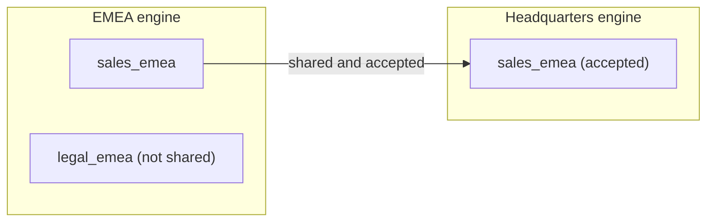

## Approach
- **One engine per site.** Each site runs its own engine, with its own database and its own [archive](../../durability/). Agents at the site talk to it.
- **Engines peer into a mesh.** Engines connected to one another form a [mesh](../../architecture/distributed-mesh-architecture/). There is no central store and no hub.
- **What crosses is chosen per peer.** A site shares a policy, or all of them, with a peer; the peer accepts a policy by its id. Only what is both shared and accepted crosses: the policy first, then its lanes, whole, with their records. Nothing crosses by default.
- **What arrives is passed on.** An engine passes on what it received to its own peers, under its own shares.
- **Each engine works on its own.** An engine reads and writes with no connection to its peers, and exchanges what it missed when it reconnects. An air-gapped site runs fully offline, and exchanges only if and when it is connected.

## Example
The EMEA engine holds two policies: `sales`, with the lane `sales_emea`, and `legal`, with the lane `legal_emea`. It shares `sales` with headquarters, and headquarters accepts it. Records in `sales_emea` cross to headquarters, and headquarters' agents read them like their own, within their agent profiles. `legal` is not shared, so `legal_emea` and its records never leave the region.

## Reference

The mesh, peering and exchange: [mesh](../../architecture/distributed-mesh-architecture/).
